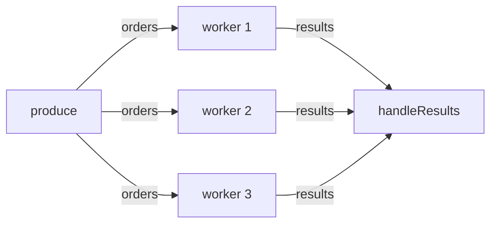

# Go Concurrency Practice: Order Processing Pipeline

A small Go program I built to practice concurrency. It generates orders, processes them with a pool of workers, and collects the results, including errors, in one place.

## What it does

1. A **producer** sends 20 orders (Pizza or Burger) on a channel.
2. **3 workers** take orders from that channel and process them. Processing takes a random 0–300 ms, and some orders fail on purpose (out of stock, payment declined).
3. A **reader** collects every result, prints it, and counts successes and failures.
4. Pressing **Ctrl+C** cancels everything cleanly, even orders in the middle of processing.



## What I'm using

| Tool                               | Used for                                                    |
| ---------------------------------- | ----------------------------------------------------------- |
| Goroutines                         | Running the producer and workers at the same time           |
| Unbuffered channels                | Handing orders and results between goroutines               |
| `sync.WaitGroup` (`wg.Go`)         | Knowing when all workers are done                           |
| `context` + `signal.NotifyContext` | Cancelling everything on Ctrl+C                             |
| `select`                           | Waiting on a channel or cancellation, whichever comes first |
| `time.After`                       | A sleep that can be interrupted by cancellation             |
| `errors.Is` + `%w`                 | Telling different error types apart                         |
| `math/rand/v2`                     | Random items, delays and failures                           |

## Run it

Requires **Go 1.25+** (for `sync.WaitGroup.Go`).

```bash
go run .
```

Check for data races:

```bash
go run -race .
```

Press `Ctrl+C` while it runs to see cancellation.

## How it's structured

| Function        | Job                                                                          |
| --------------- | ---------------------------------------------------------------------------- |
| `produce`       | Creates the `orders` channel, sends orders, closes it when done or cancelled |
| `startWorkers`  | Starts the workers, closes `results` once all of them are done               |
| `worker`        | Takes orders until the channel closes or the context is cancelled            |
| `processOrder`  | The actual work for one order (where a DB call would go in a real app)       |
| `handleResults` | Reads all results, prints them, returns a `Summary`                          |

Each function that creates a channel also closes it and returns it receive-only (`<-chan`), so `main` only connects the pieces.

## Error handling

Workers never print or decide anything about errors. Each result carries its error in a `Result` struct, and `handleResults` decides what to do:

```go
type Result struct {
	Worker int
	Order  Order
	Err    error
}
```

A sentinel error lets the reader react to specific failures:

```go
var ErrOutOfStock = errors.New("out of stock")

return fmt.Errorf("order %d %s: %w", order.ID, order.Item, ErrOutOfStock)

if errors.Is(r.Err, ErrOutOfStock) { ... }
```

`%w` wraps the error so `errors.Is` can find it. With `%v`, the text looks the same but `errors.Is` returns false.

## What I learned / tips

### Channels

- **Unbuffered** channels are synchronous: the sender waits until a receiver takes the value.
- **Buffered** channels only let the sender skip waiting while there's free space. When the buffer is full, it blocks again.
- **A buffer is a performance tweak, not a fix.** The program must work correctly with an unbuffered channel. If it only works because the buffer is big enough, it will deadlock when the input grows.
- `len(ch)` is the number of items _currently waiting_ in a channel, not its capacity.

### Closing channels

- **The sender closes, never the reader.**
- **One sender:** it closes the channel itself when done (use `defer close(ch)` so it also closes on early return).
- **Many senders:** someone has to wait for all of them first. That's the `wg.Wait()` then `close(results)` goroutine.
- `for v := range ch` only ends when the channel is closed. Forgetting to close it means the loop waits forever.

### Blocking main

- When `main` returns, the whole program exits and all goroutines are killed.
- `handleResults` runs in the main goroutine and blocks until `results` is closed. That's what keeps the program alive until the work is done.
- Main can't read results _and_ call `wg.Wait()` at the same time. That's why the wait-and-close goes in its own goroutine.

### Workers

- Use workers for many independent tasks that take time (network, DB, files, heavy computation), and to limit how many run at once.
- **CPU-heavy work:** about `runtime.NumCPU()` workers.
- **I/O-heavy work:** more workers, limited by things outside the program (DB pool size, API rate limits). Start with a reasonable number and measure.

### Context

- `ctx.Done()` is a channel that closes on cancel. Put it in every `select` where a goroutine could wait.
- Always `defer cancel()` (or `defer stop()`).
- In real HTTP apps, use the request's context (`r.Context()` / `c.Request.Context()` in Gin) and pass it down to DB calls.
- `context.WithTimeout` is the common choice for calls to anything outside the program.

### Shared state

- `sync.Mutex`: one goroutine at a time.
- `sync.RWMutex`: many readers at once, or one writer. Only worth it when reads clearly outnumber writes.
- Often you don't need a lock at all: if one goroutine already sees all the data (like `handleResults`), let it do the counting. _Don't communicate by sharing memory; share memory by communicating._
- Run `go run -race .` regularly.

### Errors in goroutines

| Pattern                                 | Use when                                                   |
| --------------------------------------- | ---------------------------------------------------------- |
| Result struct with `Err` (this project) | Items are independent; report every success and failure    |
| `errgroup`                              | Any error means the whole job failed; stop everything fast |
| Collect errors, then `errors.Join`      | Keep going, but only need one combined error at the end    |

- A **panic** in a goroutine crashes the whole program, and `main` can't catch it. Only `recover` at boundaries (like per HTTP request), not in every worker.

## Next steps

- [ ] Rewrite it from scratch without looking
- [ ] Break it on purpose (wrong close, no wait goroutine, remove a lock) and read the error messages
- [ ] Learn to spot goroutine leaks
- [ ] Replace `time.After` with real I/O (HTTP requests or DB queries)
- [ ] Try the fail-fast version with `errgroup`
# Go-Concurrency-Practice
